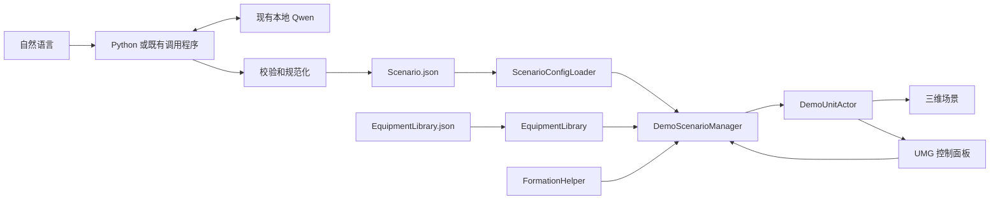

# 整体项目框架

## 目标与现状
目标：验证“自然语言 → 本地 Qwen → 标准 JSON → UE5 C++ → 三维场景”。当前为技术验证，不开发完整仿真系统。

第一阶段 UE C++ 工程、JSON 加载、Actor 生成、模型回退和重载已实现，已通过编译、4 项 UE 自动化测试及原场景/修改场景的实际渲染验证。本文保留整体路线，具体实时验证结果以 PROJECT_STATUS.md 为准。后续功能不提前建设。

## 整体数据流


Qwen 只输出配置，不修改代码或直接操作 Actor。第一阶段不需要 Qwen、Python、阵型或 UMG 才能运行。

## 模块职责
| 模块 | 职责 | 阶段 |
| --- | --- | --- |
| ScenarioConfig | 场景和单位组的数据结构 | 1 |
| ScenarioConfigLoader | JSON 读取、字段校验、具体错误报告 | 1 |
| EquipmentLibrary | modelId 映射资源、按类型回退默认模型 | 1 |
| DemoScenarioManager | 场景加载、替换、重载，后续扩展控制入口 | 1 |
| DemoUnitActor | 单位模型、阵营、静态单位状态 | 1 |
| DemoGameMode | 启动场景管理器、提供演示视角 | 1 |
| FormationHelper | 后续队形布局计算 | 后续 |
| 简单 UMG | 控制场景、显示选中单位参数 | 3 |
| Qwen 调用程序 | 复用现有模型，生成有效配置并更新文件 | 4 |

不创建重复 Manager。运动集中在单位更新方法，未来可替换为外部仿真数据驱动，不预先引入大型插件或通信架构。

## 目标目录（尚未实施的部分仅为规划）
```text
E:/UE5Project/
├─ PROJECT_FRAMEWORK.md
├─ PROJECT_MAP.md
├─ PROJECT_STATUS.md
├─ docs/superpowers/specs/
├─ docs/superpowers/plans/           后续实施计划
├─ 素材/、素材.rar                  现有用户资源
└─ TacticalDemo/                   已创建；标注“后续”的部分尚未实施
   ├─ TacticalDemo.uproject
   ├─ Config/
   │  ├─ DefaultEngine.ini
   │  ├─ DefaultGame.ini
   │  ├─ Scenario.json
   │  └─ EquipmentLibrary.json
   ├─ Content/
   │  ├─ Maps/Demo.umap
   │  ├─ Models/
   │  │  ├─ Placeholder/
   │  │  ├─ Aircraft/
   │  │  ├─ Vehicle/
   │  │  └─ Radar/
   │  ├─ Materials/
   │  └─ UI/                       后续
   ├─ Source/
   │  ├─ TacticalDemo.Target.cs
   │  ├─ TacticalDemoEditor.Target.cs
   │  └─ TacticalDemo/
   │     ├─ TacticalDemo.Build.cs
   │     ├─ TacticalDemo.cpp
   │     ├─ ScenarioConfig.h
   │     ├─ ScenarioConfigLoader.h/.cpp
   │     ├─ EquipmentLibrary.h/.cpp
   │     ├─ DemoScenarioManager.h/.cpp
   │     ├─ DemoUnitActor.h/.cpp
   │     ├─ DemoGameMode.h/.cpp
   │     └─ FormationHelper.h/.cpp   后续
   ├─ Scripts/                     构建与验证
   └─ Tools/QwenBridge/             后续
```

基础模型可引用 Engine 资源，无需复制文件。项目地图是 Markdown 文档，Demo.umap 才是 UE 场景地图，两者分别维护。

## 配置契约
第一阶段详细契约以 [第一阶段设计](docs/superpowers/specs/2026-09-23-json-actor-demo-design.md) 为准。

| 字段 | 语义 | 阶段 |
| --- | --- | --- |
| scenarioName、units | 场景名、单位组数组 | 1 |
| id、modelId、type、side | 组标识、模型标识、类型、阵营 | 1 |
| count、position、spacing | 数量、米制位置、米制间距 | 1 |
| route | 每组 0 或 2～32 个米制静态航点，只绘制，不驱动单位移动 | 1（本次） |
| formation、speed | 队形布局、米/秒 | 后续 |
| radarRange | 米制显示半径，不做探测计算 | 3 |

高度统一为 position.z，未来 Qwen 输出 altitude 时由调用程序规范化，不维护两份高度来源。UE 内部厘米换算集中在输入边界。自然语言方向约定在 Qwen 阶段明确并写入提示词。

模型库顶层包含 defaults 和 models；defaults[type] 引用默认 modelId；models[id] 包含 type、kind、asset。第一阶段 kind=staticMesh，Blueprint 适配后续实现。模型路径只在注册表中配置。

新增模型：导入资源 → 注册模型 id → 场景引用 modelId → Reload。Blueprint 支持未实现前，不承诺 BP 资源可直接加载。

## 场景更新与错误处理
完整解析、校验、资源解析和新 Actor 创建成功后才替换旧场景。指定模型失效时按类型回退；默认模型也失效时拒绝加载并保留旧场景。只管理自身创建的 Actor。

Qwen 阶段先生成并校验候选文件，再在同目录替换有效 Scenario.json，避免读到半写入文件。连续对话将当前有效配置作为上下文，输出完整新配置，失败不覆盖旧文件。文件闭环稳定前不引入 HTTP、WebSocket 或 RPC。

## 阶段与验收
| 阶段 | 交付 | 验收要求 |
| --- | --- | --- |
| 1：JSON、聊天与场景 | 配置、注册模型、静态位置、手动应用 | 校验、错误回退、聊天模型替换有效 |
| 2：静态航迹展示 | 组级 2～32 个 waypoint、场景折线显示 | 航点校验、清除与重载有效；单位保持静止 |
| 3：后续展示与控制 | 队形、雷达范围圈、参数面板扩展 | 按后续目标另行确定范围 |
| 4：Qwen 文件闭环 | 复用现有 Qwen、固定契约、校验后写文件 | 自然语言生成有效配置，连续修改正确，UE 可重载 |
| 5：可选整合 | UE 内聊天入口 | 文件闭环成功后另定范围 |

上一阶段真实验证成功后才推进。当前验收通过聊天替换已登记模型、修改静态位置和设置静态航迹；航迹展示不代表自主运动。

## 开发与验证规则
先读 PROJECT_MAP.md 和 PROJECT_STATUS.md，再打开涉及的文件。Level 1 检查文件和配置；C++ 变化加 Level 2 增量编译；运行行为变化加 Level 3 UE 实测。不默认 Full Rebuild，不重复完整环境扫描，不重部署 Qwen。

已补装缺失的 Windows SDK 10.0.22621.0，并用现有 MSVC 14.44 完成 UE5.3.2 项目编译。后续沿用环境记录。未执行或失败的检查如实记录；设计完成不能写成实现完成。
